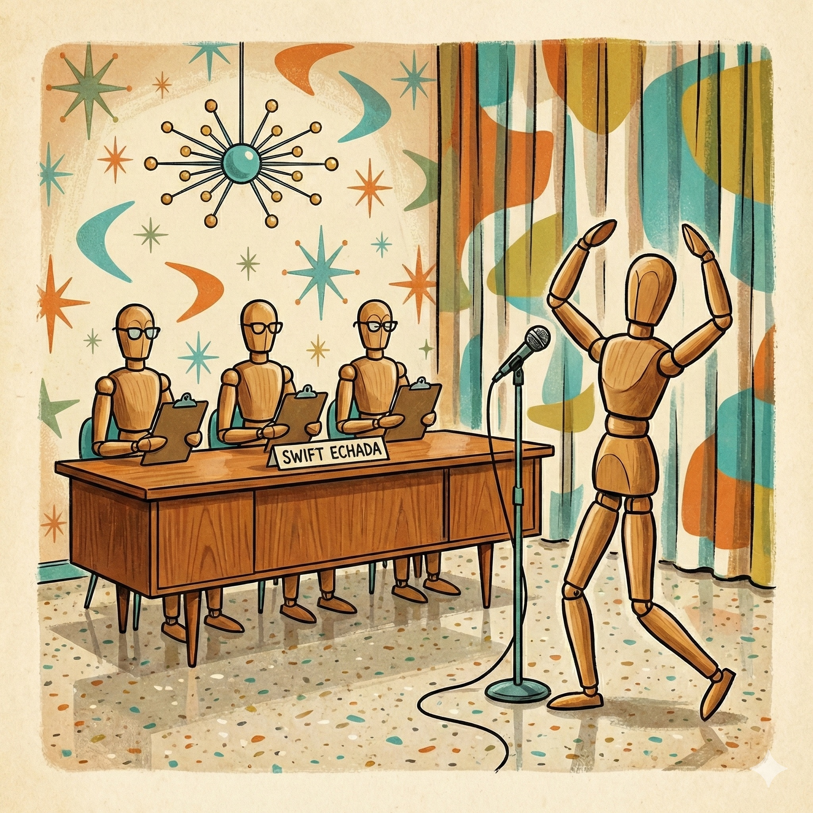

<p align="center">
    
</p>

# SwiftEchada

Voices for screenplay casts. Generates on-device custom voices from text prompts (via [SwiftVoxAlta](https://github.com/intrusive-memory/SwiftVoxAlta)), writes them into each character's record (a `.dossier` bundle, [dossier-format](https://github.com/intrusive-memory/dossier-format)), and records them in CAST.md (via [SwiftReparto](https://github.com/intrusive-memory/SwiftReparto)). Apps link the same voice builder through the `EchadaVoice` library.

**3.0.0:** echada no longer discovers cast members. Build CAST.md from the screenplays with [`personaje cast-discover`](https://github.com/intrusive-memory/SwiftPersonaje), then run `echada cast`.

**Ownership split (v2.0.0)**: `PROJECT.md` is [SwiftProyecto](https://github.com/intrusive-memory/SwiftProyecto)'s config file — project identity, episode discovery, TTS config. `CAST.md` is SwiftReparto's config file — the cast roster, voice prompts, and `.vox` voice pointers. All `echada` generate stages read and write `CAST.md`; an older `PROJECT.md` that still has a `cast:` block is migrated into `CAST.md` automatically (see [Migrating older projects](#migrating-older-projects)).

## Requirements

- macOS 27+ (Apple Silicon). echada 2.0.x is the last release for macOS 26.
- CAST.md names in canonical form (`reparto canonicalize`), because they become file names.
- Swift 6.2+
- **MLX framework** (via Homebrew)

### Install MLX

SwiftEchada requires the MLX framework for on-device voice generation:

```bash
brew install mlx
```

This installs the compiled Metal shader library (`mlx.metallib`) required for GPU acceleration.

## Installation

### Homebrew

```bash
brew tap intrusive-memory/tap
brew install echada
```

### Swift Package (Library Only)

Add to your `Package.swift`:

```swift
dependencies: [
    .package(url: "https://github.com/intrusive-memory/SwiftEchada.git", from: "1.0.0"),
]
```

The library target depends only on [SwiftReparto](https://github.com/intrusive-memory/SwiftReparto) — a leaf package that owns the CAST.md schema. All ML and voice dependencies (and SwiftProyecto, for project-level PROJECT.md fields) are CLI-only.

## CLI Usage

The `echada` CLI's top-level commands are `cast`, `generate`, `sample`,
`migrate`, `voice`, `auth`, and the hidden `test-voice`. There is no default subcommand —
running bare `echada` prints help; invoke a command explicitly.

Every command that touches the cast roster accepts `--cast <filename>`
(default `CAST.md`): a bare filename resolved beside `--project` — path
separators are rejected.

### `echada cast` — the voice pipeline

`echada cast` runs the voice pipeline end to end:

```
PROJECT.md + CAST.md  →  generate prompt  →  generate vox
```

If `--project` (default `PROJECT.md`) is absent, it is scaffolded automatically
from the surrounding directory (inferred title, author, `episodesDir`,
`filePattern`) with no LLM involved. The `--cast` roster file (default
`CAST.md`) is then ensured beside PROJECT.md — seeded from a legacy `cast:`
block when one is present, created empty otherwise; an existing roster is left
untouched. Then it runs, in order: `generate prompt` (write a `voicePrompt`
per member via the language model chosen with `--llm`) and `generate vox`
(synthesize an on-device `.vox` voice per member). Every stage is idempotent,
so re-running only fills the gaps. An empty roster stops the pipeline: build it
with `personaje cast-discover` first.

```bash
echada cast [--project <path>] [--cast <filename>] [--character <name>] [--tts-model <0.6b|1.7b>] [--language <bcp-47>]... [--accent <directive>] [--llm <model>] [--force] [--dry-run] [--verbose]
```

`--force` cascades to every stage's own force flag (prompt overwrite, vox
regenerate). `--cast` forwards to both stages;
`--tts-model`, `--language`, and `--accent`
forward to the vox stage; `--llm` forwards to the prompt stage; `--character` forwards to the prompt and vox stages.
`--dry-run` runs the offline bootstrap and migration steps but stops before
the model-backed prompt and vox stages.

### `echada generate` — run a single stage

For fine-grained, per-stage control, each pipeline step is also available
standalone under the `generate` namespace:

```bash
echada generate prompt [--project <path>] [--cast <filename>] [--character <name>] [--llm <model>] [--force] [--dry-run] [--verbose]
echada generate vox [--project <path>] [--cast <filename>] [--character <name>] [--tts-model <0.6b|1.7b>] [--language <bcp-47>]... [--accent <directive>] [--force-regenerate] [--dry-run] [--verbose]
```

- **`generate prompt`** — examines each cast member's dialogue and writes a
  `voicePrompt` into CAST.md. Fills empty prompts only unless `--force`.
  `--llm` picks the model: `on-device` (default), `pcc` (Apple Private Cloud
  Compute), or any `account:model` configured with `echada auth`, such as
  `anthropic:claude-sonnet-5-5` or `openai:gpt-5.6`. Off-device models receive
  the characters' dialogue.
- **`generate vox`** — synthesizes an on-device `.vox` voice from each
  member's `voicePrompt` using Qwen3-TTS, recording the output path under
  `voices.voxalta` in CAST.md (relative to CAST.md's directory). The file goes
  into the character's record: beside the member's `manifest:`
  (`<bundle>/voice/<NAME>.vox`), else at the path `voices.voxalta` already
  names (regenerated in place), else
  `characters/<NAME>.dossier/voice/<NAME>.vox` (PROJECT.md
  `personaje.charactersDir` overrides `characters`). The name is the exact
  character name, spaces and all. `--dry-run` shows each destination. echada
  creates the folder but never `manifest.json`; SwiftDossier or Personaje
  adopts it. Uses a two-phase pipeline: **Phase
  A** — VoiceDesign 1.7B generates candidate WAVs from voice prompts; **Phase
  B** — Base model creates voice locks (speaker embeddings) and exports `.vox`
  bundles. `--language` may be repeated to cast multiple languages into one
  `.vox` (e.g. `--language es --language en`); `--accent` applies a delivery
  directive (e.g. `"slow southern drawl"`) to every character's voice.

### `echada auth` — language model credentials

```bash
echada auth login anthropic        # prompts for the API key, no echo
pbpaste | echada auth login openai # or pipe it in
echada auth status                 # what's configured, and where it comes from
echada auth check anthropic:claude-haiku-5-5
echada auth logout anthropic
```

Credentials are stored in the Keychain by
[SwiftLlavero](https://github.com/intrusive-memory/SwiftLlavero) and shared with
every tool that uses it. `ANTHROPIC_API_KEY` and `OPENAI_API_KEY` work too.

### `echada sample` — playable samples for the dossier

```bash
echada sample "THE PRACTITIONER"                       # voice/sample-neutral.m4a
echada sample MAYA --model 0.6b                        # voice/sample-neutral-0.6b.m4a
echada sample MAYA --variant whisper --text "Did you sleep at all?"
echada sample MAYA --all-variants --json               # every voice/samples.yaml entry
```

`neutral` exports the sample already embedded in the `.vox` (no synthesis).
Other variants speak `--text`, CHARACTER.md's `sampleLine`, or a fixed neutral
sentence, with the variant as the delivery instruction. `--json` returns
`variant`, `model`, `language` and `sampleText` for the manifest writer.

### `echada migrate voices` — move old voices into the character record

```bash
echada migrate voices          # dry run: the plan, plus unclaimed voices/ files
echada migrate voices --apply  # copy, verify, rewrite CAST.md, then remove the old files
```

Run `reparto canonicalize` first if any name isn't canonical. Paths outside the
project (shared `common-voices/`) are skipped. Any failure under `--apply`
restores CAST.md and leaves the old files where they were.

### Migrating older projects

Projects from before v1.0.0 keep their roster in PROJECT.md's `cast:` block.
echada 2.0 migrates them automatically: the first time `echada cast` or any
`generate` stage opens such a project, it

1. copies the roster into CAST.md (an existing CAST.md wins on any field the
   two disagree about; missing members are added and printed),
2. checks that every character made it into CAST.md, and stops without
   touching PROJECT.md if one didn't,
3. saves the original as `PROJECT.md.bak` (or `.bak.1`, … if one exists),
4. removes only the `cast:` lines and stamps `schemaVersion: 5`. Every other
   byte of PROJECT.md is kept.

`generate … --dry-run` describes the migration without doing it. `echada cast
--dry-run` runs the offline steps for real, so it does migrate.

> **Produciesta compatibility:** a Produciesta build that still reads cast from
> PROJECT.md finds no voices in a migrated project. Render migrated projects
> with a CAST.md-aware Produciesta, or restore `PROJECT.md.bak` until you can.

### Generate a Voice

Generate a single `.vox` voice file from a text prompt (no PROJECT.md required).

```bash
echada voice "A warm female voice with a slight southern accent" --output my-voice.vox --name "Narrator"
```

Appends to existing `.vox` files for multi-model support.

### Migrating from pre-0.16 `echada`

This is a **breaking change** to the CLI surface (hard cut, no back-compat
alias):

| Old (pre-0.16) | New |
|-----------------|-----|
| `echada cast` (produced `.vox` only) | `echada generate vox` |
| `echada prompt` | `echada generate prompt` |
| `echada cast` (bare, no project) | `echada cast` now runs the **full pipeline** (bootstrap → cast → prompt → vox), not just `.vox` generation |

There is no runtime breadcrumb pointing you here: `echada prompt ...` now
fails with ArgumentParser's generic "unknown subcommand" error, and the old
`.vox`-only `cast` flag usage silently runs the full pipeline instead (since
`cast` was repurposed) rather than erroring. If a script or CI job invokes
`echada prompt` or expects `echada cast` to only touch `.vox` files, update it
to the table above.

## Library Usage

### Building voices in an app (`EchadaVoice`)

```swift
import EchadaVoice
import SwiftReparto

let builder = VoiceBuilder(castDirectory: castURL.deletingLastPathComponent())

// One call: design a voice from member.voicePrompt and write one .vox holding
// both the 1.7B and 0.6B embeddings to the member's dossier folder.
let result = try await builder.buildVoice(for: member) { progress in print(progress) }
document.cast[index] = result.updating(member)   // write CAST.md through SwiftReparto

// Or let a person choose: render candidates, play them, lock one.
let auditions = try await builder.audition(for: member, count: 3)
let locked = try await builder.lock(auditions[1], for: member)

// Playable sample for the dossier page.
let sample = try await builder.renderSample(for: member, variant: "neutral")
```

The library writes `.vox` and `.m4a` files only. CAST.md goes through
SwiftReparto and `manifest.json` through SwiftDossier. It has no ArgumentParser
dependency, honours task cancellation, unloads its models after each call, and
reads models from the shared App Group cache (`group.intrusive-memory.models`).

### Character Profiles

```swift
import SwiftEchada

let profile = CharacterProfile(
    name: "NARRATOR",
    gender: .male,
    ageRange: "40s",
    description: "A deep, authoritative voice with warmth",
    voiceTraits: ["deep", "authoritative", "warm"],
    summary: "Deep authoritative male narrator voice"
)
```

### Sample Sentences

Voice-audition sample text is curated per language, not generated. English
draws on standard speech-science reading passages (*The North Wind and the
Sun*, the *Rainbow Passage*, *Please Call Stella*). Each character gets a fixed
selection chosen from its name, so its `.vox` is reproducible. Pass
`--audition-variant N` to `echada cast` or `echada generate vox` to force one
selection for every character.

```swift
// In EchadaVoice (package-internal):
let text = try AuditionSentence.auditionSentence(language: "en", character: "NARRATOR")
```

## Architecture

```
Library:  SwiftEchada → SwiftReparto (CAST.md schema — a leaf package)
Voice:    EchadaVoice → SwiftEchada + SwiftReparto + SwiftVoxAlta + MLX + vox-format (no ArgumentParser)
CLI:      echada → EchadaCLICore → EchadaVoice + SwiftProyecto + SwiftLlavero + ArgumentParser
```

The library contains pure data types and utilities with no ML dependencies. SwiftReparto is the single writer of CAST.md — `echada` mutates a `CastDocument` and hands it back for serialization. SwiftProyecto appears only in the CLI, for project-level PROJECT.md fields (`title`, `episodesDir`, `filePattern`, `tts.model`). Voice generation is entirely prompt-based — voice descriptions are text strings in CAST.md, and the CLI generates `.vox` files from these prompts with no LLM involvement.

## Building

```bash
# Build CLI
make build

# Run tests
make test

# Release build + copy to ./bin
make release

# Clean
make clean
```

All `make` targets use `xcodebuild` (required for Metal shader compilation).

## Related Projects

- [SwiftReparto](https://github.com/intrusive-memory/SwiftReparto) — CAST.md schema, parser, and serializer (cast roster ownership)
- [SwiftProyecto](https://github.com/intrusive-memory/SwiftProyecto) — Project metadata and file discovery (PROJECT.md ownership)
- [SwiftVoxAlta](https://github.com/intrusive-memory/SwiftVoxAlta) — On-device neural TTS voice generation
